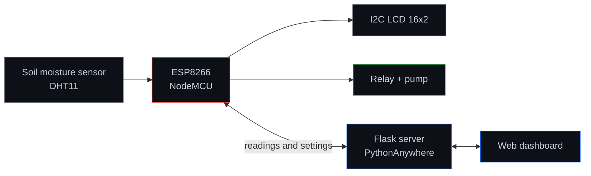

<div align="center">


**A small IoT system that monitors soil moisture, temperature, and humidity, and waters plants automatically or on demand.**

[Overview](#overview) · [Features](#features) · [Architecture](#architecture) · [Hardware](#hardware) · [Getting Started](#getting-started) · [Usage](#usage)

</div>

---

## Overview

An ESP8266 reads soil and climate sensors every 2 seconds and controls a water pump through a relay. A Flask web dashboard shows live readings and lets you switch between **Auto** mode (the pump follows soil moisture thresholds) and **Manual** mode (you switch the pump yourself).

## Features

- Reads soil moisture, temperature, and humidity every 2 seconds.
- Live web dashboard with a connection indicator and a soil moisture ring.
- **Auto mode:** the pump turns on when soil is dry and off when it is wet enough, with adjustable thresholds.
- **Manual mode:** turn the pump on or off from the dashboard.
- Sensor history of recent readings.
- Keeps watering with the last known settings if the internet goes down.

## Architecture



## Hardware

| Component | Purpose |
|---|---|
| ESP8266 NodeMCU | Microcontroller with Wi-Fi |
| Soil moisture sensor | Soil moisture reading |
| DHT11 | Temperature and humidity |
| I2C LCD (16x2) | Local display |
| Relay module + water pump | Irrigation (an LED works for testing) |

> **Safety:** never wire a real pump directly to the ESP8266. Always use a relay or driver with power from a separate supply.

## Tech Stack

| Layer | Technology |
|---|---|
| Firmware | Arduino IDE, C++ (`smart_farm.ino`) |
| Server | Python, Flask |
| Dashboard | HTML, CSS, JavaScript |
| Hosting | PythonAnywhere |

## Project Structure

```text
Smart_Farm-Embedded-Project/
├── smart_farm.ino         # ESP8266 firmware
├── app.py                 # Flask web server
├── requirements.txt       # Python dependencies
├── templates/index.html   # Dashboard page
└── static/
    ├── style.css          # Dashboard styles
    └── script.js          # Live updates
```

## Getting Started

**Prerequisites:** Arduino IDE, Python with pip, and a PythonAnywhere account for online hosting.

1. **Wire the hardware:** connect the sensors, LCD, and relay (or LED) to the ESP8266.
2. **Configure the firmware:** open `smart_farm.ino` in Arduino IDE and set your Wi-Fi name, password, and server URL (your local IP first).
3. **Run the server locally:**
   ```bash
   pip install -r requirements.txt
   python app.py
   ```
   Check it at `http://localhost:5000`.
4. **Upload the firmware** to the ESP8266 from Arduino IDE.
5. **Deploy to PythonAnywhere:** upload the same files, set up the web app, then update `SERVER_URL` in the firmware to your PythonAnywhere link and upload it again.

## Usage

1. **Status dot (top right):** green and pulsing means live data, orange means waiting, red means the device is offline.
2. **Soil ring:** soil moisture as a percentage, labeled Dry, Very dry, or Moist.
3. **Temperature and humidity** each have their own card.
4. **Mode:** tap **Auto** to water automatically, or **Manual** to control the pump.
5. **Pump button (Manual mode):** shows ON or OFF. It dims while changing; wait a few seconds for it to update.
6. **Irrigation settings (Auto mode):** the first slider sets the soil % that turns the pump on; the second sets how much wetter the soil must get before it turns off. Tap **Save settings**.
7. **Sensor history:** scroll down to see past readings.

The dashboard refreshes about every 2 seconds, which is close enough to feel live.

---

<div align="center">
<sub>Part of the <a href="https://github.com/nixxinix">nixxinix</a> project portfolio</sub>
</div>
